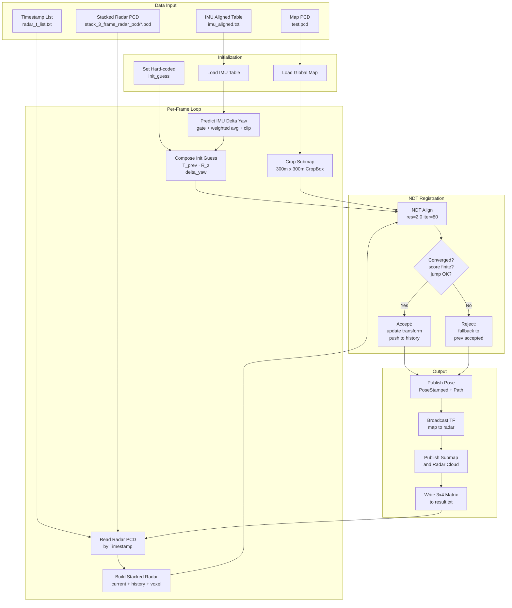

# SDC Lab - Radar-LiDAR NDT Localization Report

## 1. System Overview

本系統使用 4D 毫米波雷達點雲與 LiDAR 地圖進行 NDT (Normal Distributions Transform) scan matching 定位。整體 pipeline 分為三個階段：

```
LiDAR Map (map.pcd)          Raw Radar PCD (1800 frames)
       |                              |
  map_modified.cpp             radar_preprocessor.py
       |                              |
 preprocessed_map.pcd     preprocessed_radar_pcd/*.pcd
                                + ego_velocity.csv
                \                /
                 localization.cpp
                       |
                result_*.txt --> txt_to_idx_x_y_yaw.py --> .csv (Kaggle)
```

所有參數統一由 `config/params.yaml` 管理，實驗時只需修改此檔案。

---

## 2. Stage 1: LiDAR Map Preprocessing (`map_modified.cpp`)

**功能**: 將原始 LiDAR 地圖點雲進行清理與降採樣，產生乾淨的定位用地圖。

**Pipeline**:

1. **載入原始地圖** - 讀取 `lidar_map_pcd_path` 指定的 PCD 檔
2. **高度濾波 (PassThrough)** - 移除 z 軸範圍外的點 (`lidar_z_min` ~ `lidar_z_max`)
3. **RANSAC 地面移除** - 使用 `SACMODEL_PLANE` 擬合地面平面，移除地面點 (`ransac_distance_threshold`)
4. **Voxel Grid 降採樣** - 以 `lidar_voxel_size` 為 leaf size 進行體素降採樣
5. **Statistical Outlier Removal** - 移除離群點 (`sor_mean_k`, `sor_std_dev`)
6. **儲存 & 發布** - 儲存為 `preprocessed_map_save_path`，並發布至 `/lidar_map` 和 `/lidar_map_for_ndt` topics (latched)

**相關參數** (`params.yaml`):

| 參數                           | 預設值                      | 說明                    |
| ------------------------------ | --------------------------- | ----------------------- |
| `lidar_map_pcd_path`         | Track1/map.pcd              | 原始地圖路徑            |
| `preprocessed_map_save_path` | Track1/preprocessed_map.pcd | 輸出路徑                |
| `lidar_z_min`                | -1.0                        | 高度下限 (m)            |
| `lidar_z_max`                | 4.0                         | 高度上限 (m)            |
| `ransac_distance_threshold`  | 0.2                         | RANSAC 平面距離閾值 (m) |
| `lidar_voxel_size`           | 0.3                         | 降採樣 leaf size (m)    |
| `sor_mean_k`                 | 30                          | SOR 鄰域點數            |
| `sor_std_dev`                | 1.0                         | SOR 標準差倍率          |

---

## 3. Stage 2: Radar Preprocessing (`radar_preprocessor.py`)

**功能**: 對原始 4D 雷達點雲進行濾波、ego velocity 估測與多幀累積。

**Pipeline**:

1. **單幀濾波** - RCS 閾值、高度範圍、距離範圍篩選
2. **Ego Velocity RANSAC 估測** - 利用 Doppler (RangeRate) 觀測模型 `v_r = -D @ v_ego` 進行 RANSAC，其中 D = [cos(az)cos(el), sin(az)cos(el), sin(el)]，200 次迭代，3 點取樣，再以所有 inlier 重新擬合
3. **多幀累積** - 滑動視窗累積 `accumulate_frames` 幀，以 ego velocity 進行運動補償（平移），最後 voxel downsample

**輸出**:

- `preprocessed_radar_pcd/{timestamp_nsec}.pcd` - 每幀累積後的點雲 (fields: x y z intensity)
- `preprocessed_radar_pcd/ego_velocity.csv` - 每幀 ego velocity (timestamp_nsec, vx, vy, vz)

**相關參數** (`params.yaml`):

| 參數                         | 預設值                | 說明                             |
| ---------------------------- | --------------------- | -------------------------------- |
| `radar_pcd_folder`         | Track1/raw_radar_pcd/ | 原始雷達 PCD 目錄                |
| `rcs_min_threshold`        | -10.0                 | RCS 最小閾值 (dBsm)              |
| `radar_z_min`              | -1.5                  | 雷達高度下限 (m)                 |
| `radar_z_max`              | 3.0                   | 雷達高度上限 (m)                 |
| `range_min`                | 1.5                   | 最小距離 (m)                     |
| `range_max`                | 80.0                  | 最大距離 (m)                     |
| `doppler_inlier_threshold` | 0.15                  | Doppler RANSAC inlier 閾值 (m/s) |
| `accumulate_frames`        | 10                    | 累積幀數                         |
| `accumulate_voxel_size`    | 0.3                   | 累積後降採樣 leaf size (m)       |

---

## 4. Stage 3: NDT Localization (`localization.cpp`)

**功能**: 讀取 preprocessed 資料，執行 two-stage NDT scan matching 定位。

### 4.1 Pipeline (每幀)

1. **Init Guess 決定**

   - 第一幀：使用 `params.yaml` 的 `init_guess` (row-major 3x4 matrix)
   - 後續幀：上一幀結果 + ego velocity prediction (`R_map * v_ego * dt`)
2. **Submap 擷取** (帶快取)

   - 以 init_guess 位置為中心，`submap_size` 為邊長，CropBox 裁切地圖
   - 只在移動距離 > `submap_rebuild_dist` 時重建，否則複用快取
3. **Coarse NDT** (可跳過)

   - Resolution: `ndt_coarse_voxel` (1.5m)，最大 20 次迭代
   - 當上一幀 fitness score < `coarse_skip_threshold` 時跳過，直接使用 init_guess
4. **Fine NDT + RCS Weighting**

   - RCS 加權：計算 RCS z-score -> sigmoid -> 映射至 [0.5, 2.0]，weight > 1.0 的點複製一份
   - Resolution: `ndt_fine_voxel` (0.5m)，最大 `ndt_max_iterations` 次迭代
5. **Degeneracy Detection**

   - 將對齊後的雷達點與 submap 做 KdTree nearest neighbor search (每 3 個點取樣 1 個)
   - 計算殘差協方差矩陣 H 的特徵值比 (lambda_max / lambda_min)
   - 若比值 > `degenerate_ratio_threshold`，在退化方向上將位移縮減 80%
6. **Pose Validation & Smoothing**

   - Fitness score > `fitness_fail_threshold` 或未收斂 -> 保持上一幀 pose
   - 跳躍距離 > `max_jump_distance` -> 拒絕此幀
   - EMA 平滑：`pose = alpha * ndt_result + (1-alpha) * prev_pose`

### 4.2 加速優化

| 優化策略          | 說明                                  |
| ----------------- | ------------------------------------- |
| Submap 快取       | 移動 > 30m 才重建 submap 和 KdTree    |
| Submap 縮小       | 200m -> 100m                          |
| Coarse NDT 跳過   | 上一幀 score 好時直接跳過 coarse 階段 |
| NDT 迭代縮減      | Coarse 30->20, Fine 50->30            |
| Degeneracy 降採樣 | 每 3 個點取 1 個 + 複用快取 KdTree    |

### 4.3 ROS Topics

| Topic                           | 類型        | 說明                                     |
| ------------------------------- | ----------- | ---------------------------------------- |
| `/4D_radar`                   | PointCloud2 | 當前幀雷達點雲                           |
| `/4D_radar_submap_pc`         | PointCloud2 | 當前 submap                              |
| `/tranformed_radar_pose`      | PoseStamped | 定位 pose                                |
| `/localization_path`          | Path        | 累積軌跡                                 |
| `/localization/fitness_score` | Float32     | NDT fitness score                        |
| `/localization/is_degenerate` | Bool        | 是否退化                                 |
| `/localization/status`        | String      | OK / FAILED / JUMP_DETECTED / DEGENERATE |

### 4.4 輸出檔案

- `result/result_{timestamp}.txt` - 每行為 3x4 row-major 變換矩陣 (12 個數字)
- `result/diag_{timestamp}.txt` - 診斷 CSV (frame, score, x, y, yaw, radar_pts, submap_pts, converged, status, eigen_ratio)

### 4.5 相關參數 (`params.yaml`)

| 參數                              | 預設值                        | 說明                        |
| --------------------------------- | ----------------------------- | --------------------------- |
| `radar_t_list`                  | Track1/radar_t_list.txt       | timestamp list 路徑         |
| `preprocessed_radar_pcd_folder` | Track1/preprocessed_radar_pcd | preprocessed radar PCD 目錄 |
| `preprocessed_map_path`         | Track1/preprocessed_map.pcd   | preprocessed map 路徑       |
| `ego_velocity_csv`              | .../ego_velocity.csv          | ego velocity CSV 路徑       |
| `result_save_dir`               | result/                       | 結果輸出目錄                |
| `ndt_coarse_voxel`              | 1.5                           | Coarse NDT resolution (m)   |
| `ndt_fine_voxel`                | 0.5                           | Fine NDT resolution (m)     |
| `ndt_max_iterations`            | 30                            | Fine NDT 最大迭代數         |
| `ndt_epsilon`                   | 0.001                         | NDT 收斂閾值                |
| `fitness_fail_threshold`        | 50.0                          | Score 失敗閾值              |
| `max_jump_distance`             | 1.5                           | 跳躍偵測距離 (m)            |
| `degenerate_ratio_threshold`    | 100.0                         | 退化偵測特徵值比            |
| `pose_smooth_alpha`             | 0.7                           | EMA 平滑係數                |
| `submap_size`                   | 100.0                         | Submap 邊長 (m)             |
| `submap_rebuild_dist`           | 30.0                          | Submap 重建距離閾值 (m)     |
| `coarse_skip_threshold`         | 10.0                          | 跳過 coarse 的 score 閾值   |
| `init_guess`                    | [12 floats]                   | 初始位姿 (row-major 3x4)    |

---

## 5. 完整執行步驟

所有操作在 Docker container `ros` 內執行。

### Step 0: 進入 container 並編譯

```bash
docker exec -it ros bash
source /opt/ros/noetic/setup.bash
cd /root/catkin_ws
catkin_make
source devel/setup.bash
```

### Step 1: 修改 `params.yaml`

根據要跑的 Track 修改 `config/params.yaml` 中的路徑與 `init_guess`：

**Track 1**:

```yaml
# IO paths (map_modified)
lidar_map_pcd_path: "/root/catkin_ws/src/localization/data/Track1/map.pcd"
preprocessed_map_save_path: "/root/catkin_ws/src/localization/data/Track1/preprocessed_map.pcd"

# IO paths (radar_preprocessor)
radar_pcd_folder: "/root/catkin_ws/src/localization/data/Track1/raw_radar_pcd/"

# IO paths (localization)
radar_t_list: "/root/catkin_ws/src/localization/data/Track1/radar_t_list.txt"
preprocessed_radar_pcd_folder: "/root/catkin_ws/src/localization/data/Track1/preprocessed_radar_pcd"
preprocessed_map_path: "/root/catkin_ws/src/localization/data/Track1/preprocessed_map.pcd"
ego_velocity_csv: "/root/catkin_ws/src/localization/data/Track1/preprocessed_radar_pcd/ego_velocity.csv"

# Track1 init_guess
init_guess: [-0.7739014871732518, -0.632632984298013, 0.029188959029395573, -25.31523704528809,
             0.632582897383501, -0.7743982245509299, -0.012094120483231403, -4.389283657073975,
             0.030255017582620166, 0.009104778446398086, 0.9995007438318981, -7.73]
```

**Track 2**:

```yaml
# IO paths (map_modified)
lidar_map_pcd_path: "/root/catkin_ws/src/localization/data/Track2/map.pcd"
preprocessed_map_save_path: "/root/catkin_ws/src/localization/data/Track2/preprocessed_map.pcd"

# IO paths (radar_preprocessor)
radar_pcd_folder: "/root/catkin_ws/src/localization/data/Track2/raw_radar_pcd/"

# IO paths (localization)
radar_t_list: "/root/catkin_ws/src/localization/data/Track2/radar_t_list.txt"
preprocessed_radar_pcd_folder: "/root/catkin_ws/src/localization/data/Track2/preprocessed_radar_pcd"
preprocessed_map_path: "/root/catkin_ws/src/localization/data/Track2/preprocessed_map.pcd"
ego_velocity_csv: "/root/catkin_ws/src/localization/data/Track2/preprocessed_radar_pcd/ego_velocity.csv"

# Track2 init_guess
init_guess: [-0.9478046334338953, -0.3188028892577441, 0.005576257002181274, 499.4871520996094,
              0.3186884878163892, -0.9466153206969891, 0.04854979253344068, -163.97898864746094,
             -0.010199243822116278, 0.047792807227150104, 0.9988051977251651, 7.679019927978516]
```

### Step 2: LiDAR Map Preprocessing

```bash
roslaunch localization map_modified.launch
```

輸出: `preprocessed_map.pcd` (根據 `preprocessed_map_save_path` 路徑)

完成後 Ctrl+C 結束。

### Step 3: Radar Preprocessing

```bash
cd /root/catkin_ws/src/localization/processing_codes
python3 radar_preprocessor.py ../config/params.yaml
```

輸出:

- `preprocessed_radar_pcd/{timestamp}.pcd` (每幀一個檔案)
- `preprocessed_radar_pcd/ego_velocity.csv`

### Step 4: 執行 Localization

```bash
roslaunch localization localization.launch
```

如果不需要 rviz 視覺化 (例如 SSH 環境):

```bash
roslaunch localization localization.launch use_rviz:=false
```

輸出:

- `result/result_{timestamp}.txt` - 定位結果
- `result/diag_{timestamp}.txt` - 診斷資訊

### Step 5: 轉換結果為 Kaggle 提交格式

```bash
cd /root/catkin_ws/src/localization/processing_codes
python3 txt_to_idx_x_y_yaw.py <result.txt路徑> <output.csv路徑>
```

範例:

```bash
python3 txt_to_idx_x_y_yaw.py \
    /root/catkin_ws/src/localization/result/result_20260415_143022.txt \
    /root/catkin_ws/src/localization/result/track1_submission.csv
```

輸出 CSV 格式:

```
idx,x,y,yaw
0,-25.32,-4.39,2.458
1,-25.45,-4.52,2.461
...
```

將此 `.csv` 檔上傳至 Kaggle 即可。

---

## 6. 檔案結構

```
localization/
├── config/
│   ├── params.yaml              # 所有參數統一管理
│   └── localization.rviz        # rviz 設定
├── launch/
│   ├── map_modified.launch      # LiDAR map preprocessing
│   └── localization.launch      # NDT localization + rviz
├── src/
│   ├── map_modified.cpp         # LiDAR map preprocessor node
│   └── localization.cpp         # NDT localization node
├── processing_codes/
│   ├── radar_preprocessor.py    # Radar preprocessing CLI
│   └── txt_to_idx_x_y_yaw.py   # Result txt -> Kaggle csv
├── data/
│   └── Track{1,2}/
│       ├── map.pcd              # 原始 LiDAR 地圖
│       ├── preprocessed_map.pcd # 處理後地圖 (Step 2 產生)
│       ├── raw_radar_pcd/       # 原始雷達 PCD
│       ├── preprocessed_radar_pcd/  # 處理後雷達 PCD (Step 3 產生)
│       │   ├── {timestamp}.pcd
│       │   └── ego_velocity.csv
│       └── radar_t_list.txt     # timestamp 列表
└── result/
    ├── result_*.txt             # 定位結果 (Step 4 產生)
    └── diag_*.txt               # 診斷資訊
```

- Z[-2.0~15.0], Range[1.5~75.0], Stack: 5 frames, Voxel: 0.4m, k=15, std_dev=2
- Z[-3.0~12.0], Range[2.0~55.0], Stack: 3 frames, Voxel: 0.5, k =12, std_dev=2
- Z=[-6.0~30.0], Range[3.0~70.0], Stack: 5 frames, Voxel: 0.3, k =20, std_dev=1.0

# 只做 radar PCD 前處理（跟原來一樣）

python3 radar_preprocessor.py /root/catkin_ws/src/localization/config/params.yaml

# radar PCD + 提取 IMU -> imu_aligned.txt

python3 radar_preprocessor.py /root/catkin_ws/src/localization/config/params.yaml --extract-imu

# 只提取 IMU（跳過 radar PCD）

python3 radar_preprocessor.py /root/catkin_ws/src/localization/config/params.yaml --imu-only


## 7. Kaggle Localization Variant (`src/kaggle_localization.cpp`)

### 7.1 功能概述

[kaggle_localization.cpp](src/kaggle_localization.cpp) 為專為 Kaggle 評分賽道 (Track2) 客製化之定位節點，屬於 `localization.cpp` 的輕量化變體。其核心策略為：

1. **IMU-Aided NDT Scan Matching**：利用 IMU 對齊表 (`imu_aligned.txt`) 提供的 per-frame `delta_yaw` 作為 NDT 初始猜測的 yaw 增量預測，提升收斂穩健性。
2. **Multi-Frame Radar Stacking**：維護一個滑動視窗的雷達歷史佇列 (`radar_history`)，將前幾幀的點雲以其 map 座標系姿態反變換至當前參考座標後疊加並 voxel 降採樣，以增加 NDT source 的幾何密度。
3. **Outlier Rejection with Fallback**：針對每次 NDT 解算結果檢查 `hasConverged`、fitness score、以及相對 init-guess 的位移/旋轉跳動量，若超出閾值則回退至上一個接受的 pose。

### 7.2 關鍵全域狀態

| 符號                        | 意義                                                              |
| --------------------------- | ----------------------------------------------------------------- |
| `transform_matrix`        | 目前維護的 4×4 map→radar 變換矩陣 (row-major)                   |
| `imu_table`               | `timestamp → (roll, pitch, yaw, delta_yaw, source)` 之查表容器 |
| `radar_history`           | `std::deque<RadarFrameRecord>`，保留已接受幀的 cloud + pose     |
| `imu_delta_hist`          | 最近 3 筆 raw `delta_yaw` 之滑動視窗，供加權平均                |
| `last_smoothed_delta_yaw` | EMA 狀態變數，供 `getFilteredImuDeltaYaw` 使用                  |

### 7.3 關鍵函式說明

#### `loadImuAlignedTxt(filepath)` [L132-166](src/kaggle_localization.cpp#L132-L166)

讀取 `imu_aligned.txt`，以空白分隔依序解析 `timestamp roll pitch yaw delta_yaw source`，寫入 `imu_table`。若首行含 `"timestamp"` 字串則視為表頭並跳過。回傳表格是否非空。

#### `getPredictedImuDeltaYaw(timestamp)` [L96-124](src/kaggle_localization.cpp#L96-L124)

取得該時間戳對應之 IMU 預測 yaw 增量，程序如下：

1. 若找不到對應鍵、或 `raw` 非有限值、或 `|raw| > imu_yaw_gate`，回傳 0。
2. 將 raw 值推入 `imu_delta_hist` (保持長度 ≤ 3)，以線性遞增權重 (1, 2, 3) 計算加權平均 `fused`。
3. 根據 `|fused|` 動態決定 gain：大於 0.01 取 0.15，否則取 0.05。
4. 將 `gain × fused` clip 至 `[-imu_yaw_clip, +imu_yaw_clip]`，回傳 float。

> 註：`getFilteredImuDeltaYaw` 為另一種 EMA 平滑版本 (L187-221)，使用 `imu_yaw_smooth` 作為 EMA 係數與 `imu_yaw_gain` 作為比例，目前未被 `callback` 調用。

#### `buildYawRotation(delta_yaw)` [L168-179](src/kaggle_localization.cpp#L168-L179)

建構繞 Z 軸之 4×4 齊次旋轉矩陣，用以右乘既有位姿以注入 yaw 增量。

#### `buildStackedRadarCloud(reference_pose)` [L223-248](src/kaggle_localization.cpp#L223-L248)

將當前 `radar_pc` 與 `radar_history` 中所有歷史幀的點雲疊加成單一點雲：

1. 對每一歷史紀錄計算 `T_hist→ref = reference_pose⁻¹ · record.pose_map`。
2. 透過 `pcl::transformPointCloud` 將歷史點雲轉入當前參考座標。
3. 最後以 `stack_voxel_leaf` (0.5 m) 為 leaf size 執行 `VoxelGrid` 降採樣。

#### `callback(timestamp_str)` [L327-455](src/kaggle_localization.cpp#L327-L455)

單幀定位主迴圈，依序執行：

1. **Initial Guess 建立**

   - 第一幀：將 `init_guess_base` 初始化為 Track2 的 hard-coded 4×4 矩陣 (L333-336)。
   - 後續幀：`init_guess_base = transform_matrix` (沿用上一幀)。
   - `init_guess_imu = init_guess_base · buildYawRotation(Δψ_imu)` (body frame 右乘)。
2. **Stacked Radar 建構**：呼叫 `buildStackedRadarCloud(init_guess_base)` 得到 NDT source。
3. **Submap 擷取**：以 `init_guess_base` 位置為中心，`300 m × 300 m` 的 XY 正方形 `CropBox`，Z 軸不限，裁切 `map_pc` 得到 `submap_pc`。
4. **NDT 組態與對齊**

   - `TransformationEpsilon = 1e-4`
   - `StepSize = 0.05`
   - `Resolution = 2.0 m`
   - `MaximumIterations = 80`
   - 呼叫 `ndt.align(*aligned_pc, init_guess_imu)` 取得 `T`。
5. **Jump Detection**：計算 `T` 相對 `init_guess_imu` 的 Δx、Δy、Δyaw (Δyaw 以 `normalizeAngle` 正規化至 (-π, π])。
6. **Acceptance Gate**

   - 條件：`hasConverged ∧ isfinite(score) ∧ jump_dist < max_jump_dist ∧ |Δyaw| < max_jump_yaw`。
   - 接受：`transform_matrix = T`；將當前 raw `radar_pc` 及 pose 加入 `radar_history`，佇列長度維持 ≤ `stack_frame_num - 1`。
   - 拒絕：回退 `transform_matrix = prev_accepted_transform`。
7. **輸出**

   - 呼叫 `radar_pose_publisher` 發布 `PoseStamped` 與累積 `Path`。
   - 將 `transform_matrix` 的上 3 列 (共 12 個數字) 以空白分隔寫入 `result.txt`。

### 7.4 資料處理流程 (Main Loop) [L250-325](src/kaggle_localization.cpp#L250-L325)

1. 透過 `ros::NodeHandle("~")` 載入參數：`imu_yaw_gain`、`imu_yaw_clip`、`imu_yaw_gate`、`imu_yaw_smooth`、`max_jump_dist`、`max_jump_yaw`。
2. 載入全域地圖 `test.pcd` 至 `map_pc`；載入 `imu_aligned.txt` 至 `imu_table`。
3. 開啟 `radar_t_list.txt`，逐行讀取 timestamp：
   - 從 `stack_3_frame_radar_pcd/<timestamp>.pcd` 載入當幀雷達點雲。
   - 呼叫 `callback(timestamp)` 執行定位。
   - 發布 `submap`、`tf (map→radar)`、當前雷達點雲 (frame_id = "radar")。
   - `ros::spinOnce()`。
4. 迴圈結束後關閉輸出檔。

### 7.5 輸出檔案

| 路徑                                              | 內容                                           |
| ------------------------------------------------- | ---------------------------------------------- |
| `/catkin_ws/src/localization/result/result.txt` | 每行 12 個浮點數，表示 3×4 row-major 姿態矩陣 |

### 7.6 ROS Topics

| Topic                      | 類型             | 用途                                  |
| -------------------------- | ---------------- | ------------------------------------- |
| `/4D_radar`              | `PointCloud2`  | 當前幀雷達點雲 (frame = radar)        |
| `/4D_radar_submap_pc`    | `PointCloud2`  | CropBox 後的 submap (frame = map)     |
| `/map_pc`                | `PointCloud2`  | 預留之全局地圖輸出 (目前 main 未呼叫) |
| `/tranformed_radar_pose` | `PoseStamped`  | 當前 map→radar pose                  |
| `/localization_path`     | `Path`         | 累積軌跡                              |
| TF                         | `map → radar` | 每幀 broadcast                        |

### 7.7 與 `localization.cpp` 之差異

| 面向         | `localization.cpp`                    | `kaggle_localization.cpp` |
| ------------ | --------------------------------------- | --------------------------- |
| 初始猜測來源 | Ego velocity (`R·v_ego·dt`)         | IMU `delta_yaw` 加權平均  |
| NDT 架構     | Coarse + Fine two-stage                 | Single-stage (res = 2.0 m)  |
| Submap       | 100 m 邊長 + 快取重建                   | 300 m 邊長，每幀重建        |
| 退化偵測     | 特徵值比 + 方向投影抑制                 | 無                          |
| Scan 來源    | 當前 preprocessed radar                 | 當幀 + 歷史幀 stack         |
| Pose 平滑    | EMA (`pose_smooth_alpha`)             | 無 (僅 accept / fallback)   |
| 輸出檔       | `result_<ts>.txt` + `diag_<ts>.txt` | `result.txt`              |

---

## 8. Pipeline Diagram (Mermaid)

以下為 `kaggle_localization.cpp` 之整體處理流程圖：


